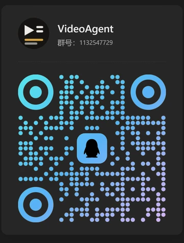
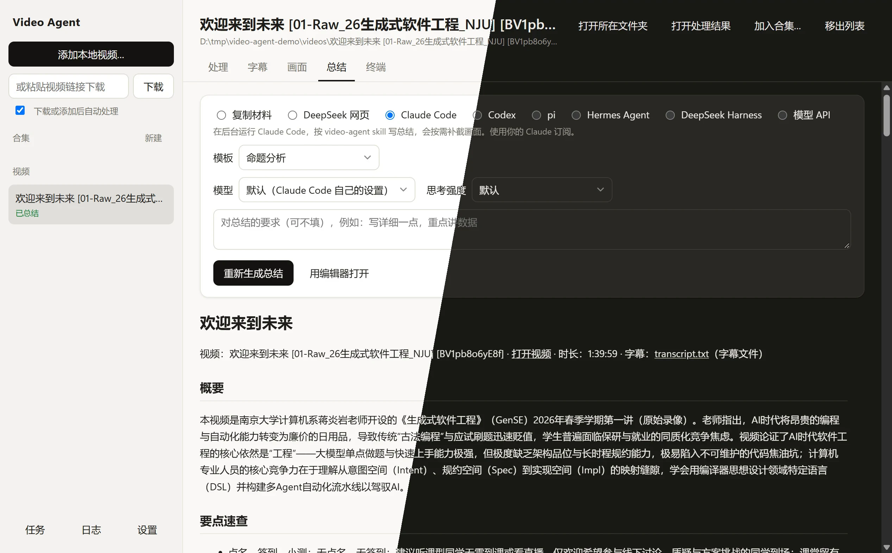
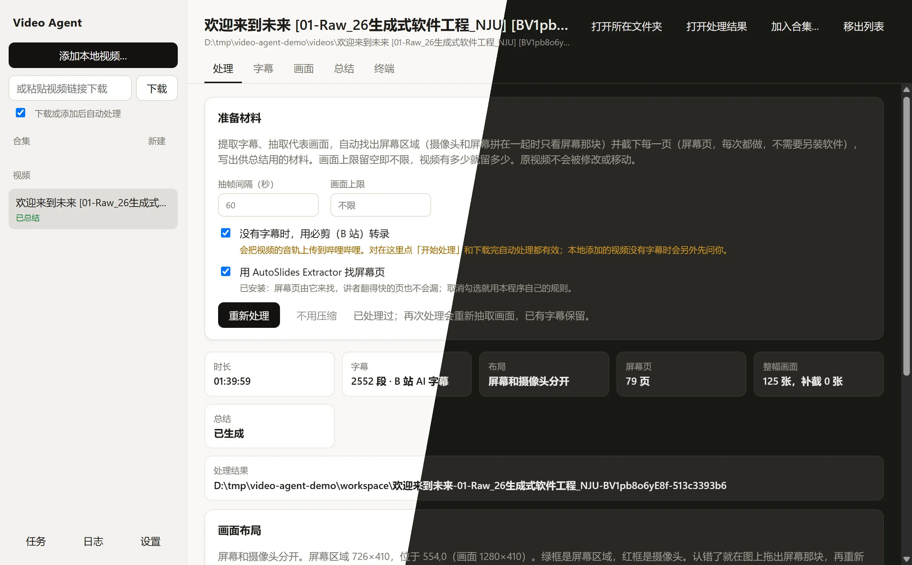
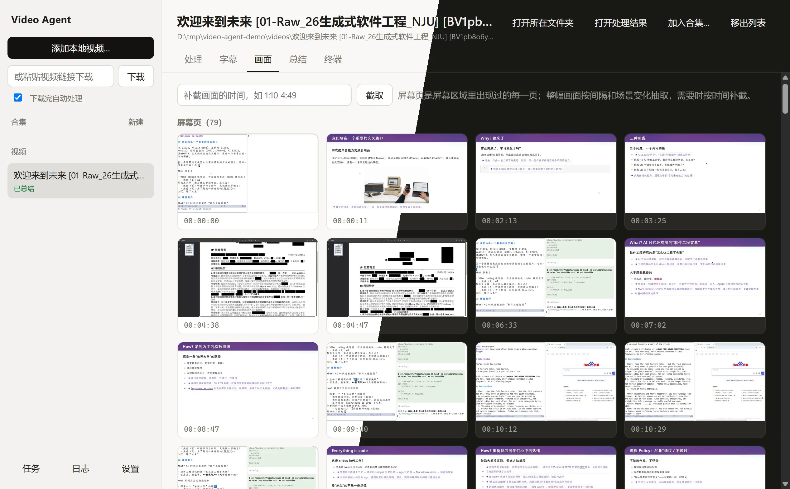
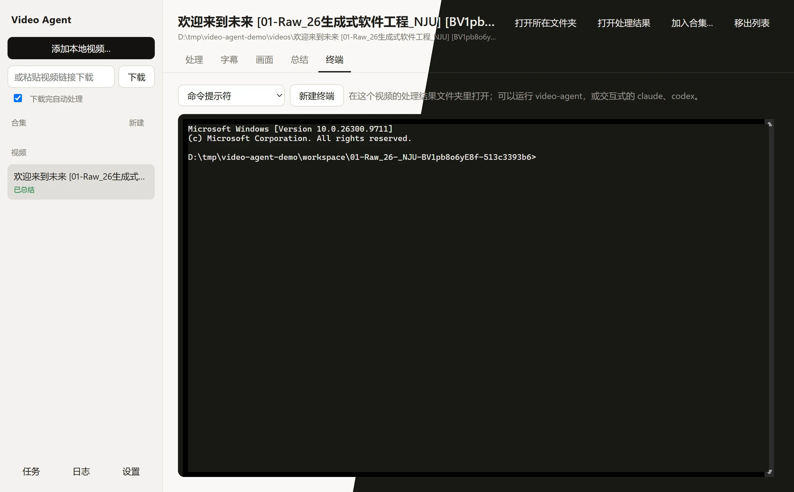

<div align="center">
  
  <h1>Video Agent</h1>
  <p>从视频到笔记：下载视频，提取字幕和屏幕画面，再由 Agent 写出带时间点和截图的总结。</p>
  <p>
    
    
    
    
    <a href="#交流群"></a>
  </p>
</div>

## 交流群

QQ 群：1132547729，用 QQ 扫码也可以加入。问题和建议也可以提 [issue](https://github.com/edsfod/video-agent/issues)。

<p align="center">
  
</p>

## 简介

<p align="center">
  
</p>

Video Agent 由三部分组成，按需取用：

- **命令行工具**：下载（可选）、提取字幕、抽取代表画面、按时间点补截画面，并把这些整理成一份供总结用的材料。也可以直接调用模型 API 写总结。
- **Agent 插件**：让 Claude Code、Codex 按同一套规则调用命令行工具、看画面、写总结。
- **桌面程序**：在窗口里完成以上全部操作，内嵌终端，支持托盘和任务日志。

只支持 Windows。

## 能做什么

- **任何来源的视频**：直接选本地文件；也可以粘贴链接，用 [yt-dlp](https://github.com/yt-dlp/yt-dlp) 下载。桌面程序默认下载或添加后自动处理（左上角可以关掉）；命令行里下载和处理是两步。
- **字幕优先**：先用视频自带的字幕或同名的 `.srt`、`.vtt` 文件（包括下载时一起存下的 `视频名.zh-CN.srt` 这类字幕），名字不同的字幕文件可以手动导入；都没有时，可以用必剪（B 站的语音识别）转录。桌面程序对下载的视频默认用必剪（可以关），本地添加的视频会先问你。
- **屏幕页和代表画面**：先识别画面布局：整个画面是屏幕、摄像头和屏幕并排、讲者小窗嵌在屏幕里，或者用摄像机拍的投影和显示器。只在屏幕那块里找翻页，用原始分辨率截下每一页幻灯片、代码和文档（多少页就留多少页），同一页逐步出现的几步合成一页，留最完整的那张。只有摄像头的视频（比如素材画面里偶尔插一张图表、截图），画面里停住两秒以上的图表和截图也当作屏幕页。另外按时间间隔和场景变化抽取整幅画面，写总结时还可以按时间补截。
- **课件**：可以导入一个放着课件图片的文件夹，有时间表的按时间表、没有的按画面对上时间，之后用它代替截下的屏幕页；[AutoSlides](https://github.com/bit-admin/Yanhekt-AutoSlides) 下载的屏幕录像（`screen_….mp4`）会自动用上它旁边的 `slides_…` 文件夹。装了 [AutoSlides Extractor](https://github.com/bit-admin/AutoSlides-Extractor) 时，屏幕页默认由它来找，讲者翻得快的页也不会漏；桌面程序的设置里可以一键下载它的免安装版。
- **压缩**：用 AV1 重新编码，分辨率不变、看不出画质差别，屏幕录像大约剩五分之一。默认只压缩本程序下载的视频；本地添加的视频要你在设置里同意后才压缩，因为会替换原文件。
- **三种总结方式**，都按总结页上选的模板写：自带「标准」和「命题分析」（把视频里的说法拆成编号的命题，标出事实、观点、推断、引用，画出论证的主线），也可以照着一份做你自己的：
  - **Agent 应用**：Claude Code 或 Codex 按插件里的 skill 写，会自己补截画面；也可以在设置里换成 pi、Hermes Agent、DeepSeek Harness 或你自己填的命令行 Agent。
  - **模型 API**：Anthropic，或 OpenAI 兼容接口（例如 ModelScope、本地 Ollama），支持工具调用的模型同样会补截画面。
  - **网页 AI**：点「复制材料」贴进任何聊天 AI；要连画面一起给，导出 zip，或者导出成文件夹（不收 zip、文件数有上限的，屏幕页会拼成总图凑进上限），每张图左下角印着编号和时间。写好的总结点「导入总结」存回来。网页 AI 看不到视频，所以可以在总结最后写一节「画面调整」：用不上的画面写「不用」，以后不再发给它；从字幕推测缺图的地方写「补截」和时间段，程序在那段时间里截几张候选，下一轮发给它挑。程序还会检查每一稿缺了模板的哪几节、字幕里哪些讲话的时间段没写到，从第二轮起请它对照字幕复查上一稿，补上漏掉的论点、例子和数字，直到复查不再补上或改正，几轮下来接近 Agent 自己看视频的效果。
  - **DeepSeek 网页版专门适配**：选「DeepSeek 网页」，程序打开一个 DeepSeek 窗口（第一次在里面登录，以后记住），自动附图、发提示词、开深度思考和智能搜索、读回答并导入，复查和补画面的几轮也自动进行；服务器繁忙、图片上传失败会重试。合集总结和学习提纲暂时不能用这一项。
- **总结的写法**：每一点都附时间点。画面当材料用：图表的走势、表格的数字、文件和条文读出来写进总结，尤其是讲者没念出来的；画面链接只放在图上确实显示了这一点的地方。视频里的说法按“视频称”转述，不当成事实；拿不准的标“需确认”。

## 安装

**桌面程序**（推荐）：从 [Releases](https://github.com/edsfod/video-agent/releases) 下载 `Video-Agent-Setup-<版本>.exe` 安装，不用另装任何东西，安装时也不需要联网：Python、FFmpeg、yt-dlp 和命令行工具都在安装包里。安装时会创建桌面和开始菜单快捷方式，并把命令行工具加进 PATH，新开的终端里就能用 `video-agent`。安装包没有代码签名，Windows SmartScreen 可能提示“未知发布者”，选“仍要运行”即可。

**只装命令行工具**：先装 [uv](https://docs.astral.sh/uv/)（`winget install astral-sh.uv`），再运行

```powershell
uv tool install https://github.com/edsfod/video-agent/releases/download/v1.2.1/video_agent-1.2.1-py3-none-any.whl
```

FFmpeg 和 yt-dlp 会作为依赖一起装上，不需要 git。电脑上已经有的 ffmpeg、ffprobe、yt-dlp（包括 [Media Downloader](https://github.com/mhogomchungu/media-downloader) 自带的 yt-dlp）会优先使用。

**Agent 插件**

- 装了桌面程序：在设置里点“安装到 Claude Code”或“安装到 Codex”，从本机安装，不需要 git。
- 没装桌面程序：下面两组命令从 GitHub 拉取插件，需要电脑上有 git。
  - Claude Code：在 Claude Code 里运行

    ```
    /plugin marketplace add edsfod/video-agent
    /plugin install video-agent@video-agent
    ```

  - Codex：在终端里运行

    ```bash
    codex plugin marketplace add edsfod/video-agent
    codex plugin add video-agent@video-agent
    ```

- pi、Hermes Agent、DeepSeek Harness：在设置里点“复制到 pi”等按钮，把 skill 文件夹复制到它们读 skill 的地方（pi 是 `~/.agents/skills`，Hermes Agent 是 `~/.hermes/skills/media`，DeepSeek Harness 是 `~/.dsh/skills`）。别的 Agent 点“复制到其他文件夹…”，选它读 skill 的文件夹；没装桌面程序时，把 `skills/video-agent/` 复制过去。

插件找不到 `video-agent` 命令时，会用 uv 临时拉取同一版本。AutoSlides Extractor 要另外安装，或在桌面程序的设置里下载免安装版。

## 桌面程序

<p align="center">
  
</p>

添加本地视频（也可以拖进窗口），或在左上角粘贴链接下载。下载 B 站视频前，先在「设置 → 账号」里登录一次哔哩哔哩，字幕（包括 AI 字幕）会一起下载，处理时直接用，不必转录；抖音要在那里打开一次网页（不用登录）；YouTube 一般不用登录，遇到年龄限制或“确认你不是机器人”时再登录，登不上就从浏览器导出 cookies.txt 导入。

每个视频有五页：

- **处理**：开始处理。屏幕页每次都会截取，不需要另装软件；装了 AutoSlides Extractor 时默认用它找屏幕页，没装时可以在「设置」里下载免安装版。
- **画面**：列出代表画面，可以按时间补截。
- **字幕**：筛选字幕，改正识别错的名字和术语。原始字幕保留，另存整理版，之后的总结都用整理版。
- **总结**：选择总结方式和模板，显示结果，点画面链接直接看图。重新总结不会覆盖原来的：已经有总结时，新写的另存为一个版本，在「版本」里查看、对比，自己决定设不设为当前，也可以给每个版本写备注。网页 AI 写的总结点「导入总结」存回来，被网页 AI 改坏的画面链接会自动修好，最后的「字幕改正」一节用来整理字幕，「画面调整」一节照着处理。
- **终端**：内嵌终端，可以选 PowerShell 7、Windows PowerShell、命令提示符或 Git Bash，打开在这个视频的处理结果文件夹里，可以直接运行 `video-agent` 或交互式的 `claude`、`codex`。

<p align="center">
  
</p>

<p align="center">
  
</p>

此外：

- **合集**：几个相关的视频可以放进一个合集（侧栏「合集」→「新建」，或在视频页点「加入合集」）。合集里的视频列在侧栏合集名下（点 ▸ 展开），不再出现在「视频」列表里，移出合集后回到列表。合集页列出各集的状态，可以一次处理、总结没做完的几集，跳过没有内容的一集并写明原因，再生成合集总结和学习提纲，也能设置各集共用的术语改正。
- **跟踪列表**：下载时粘贴的是 B 站合集、播放列表这类链接，会先问你要不要全部下载，默认放进一个以列表命名的合集并跟踪这个列表：以后在合集页点「检查新视频」只下载新出的，也可以让程序开着时每 6 小时自动检查。
- **任务队列**：下载、处理、总结都进入队列，可以一边处理一个视频一边下载另一个。左下角「任务」看每个任务的进度和输出，可以停止或重试。默认同时下载 3 个、处理 1 个（处理很吃 CPU）、总结 2 个，可在设置里改（DeepSeek 网页只有一个窗口，同时只跑 1 个）；同一个视频的处理和总结不会同时进行。下载好的视频会自动排进处理，网站给的字幕随之导入；必剪转录要上传音频，不会自动进行。
- **托盘和日志**：关闭窗口时程序缩到托盘，任务继续在后台运行（可在设置里关掉）。每个任务的完整输出都记在日志里，点左下角「日志」查看。
- **总结模板**：模板是总结的规则和格式，在总结页上选用哪一份，合集总结和学习提纲也用它。在「设置 → 总结模板」里可以编辑自带的（会生成你自己的版本并用编辑器打开；更新程序不会覆盖它，自带的有改动时会提示你对比），也可以照着一份新建、起个名字，改成更长、更短或固定要哪几节。Agent 的 skill 流程只能查看，不能改。
- **更新**：启动时会查一次有没有新版本，只提示，不会自己下载（可在设置里关掉）。点「下载并更新」，只下载和当前版本不同的部分；再点「重启并安装」，装完自动重新打开。依次尝试 github.com、GitHub API 和下载镜像；更新文件带签名，对不上签名就不会安装。

## 命令行

```powershell
video-agent download "https://www.bilibili.com/video/BV..." -o D:\Videos
video-agent process "D:\Videos\lecture.mp4" -o D:\Video-Work
video-agent summarize "D:\Videos\lecture.mp4" -o D:\Video-Work
```

`download` 把网站提供的字幕存在视频旁边，`process` 会自动用上；B 站只给登录的账号看字幕，命令行用 `--cookies cookies.txt` 传入登录状态。`process` 在工作区里为每个视频建一个文件夹，放字幕、代表画面（`frames/`）、总结材料（`summary-context.md`）和 `manifest.json`，原视频不会被修改或移动；识别出的布局画在 `frames/<本次运行>/layout.jpg` 上，认错了用 `--screen-region X,Y,宽,高` 指定。`summarize` 用模型 API 写 `总结.md`，先用 `video-agent config --provider anthropic --set-key` 设置一次（key 存在 Windows 凭据管理器里）。

用网页 AI 时，`pack` 打出提示词（`--zip` 连画面一起打包，`--folder` 导出成文件夹），写好后用 `summarize --import 文件.md` 存回来；导入时提示还要下一轮（复查、补画面）的，用 `pack --follow-up` 生成下一轮：

```powershell
video-agent pack "D:\Videos\lecture.mp4" -o D:\Video-Work --zip D:\lecture-材料.zip
video-agent summarize "D:\Videos\lecture.mp4" -o D:\Video-Work --import D:\总结.md
```

还有按时间补截（`frame`）、改正字幕（`fix`）、合集和跟踪连载（`collection`）、总结版本（`versions`）、总结模板（`template`）、压缩（`compress`）、查看用到的外部程序（`tools`）等。全部命令和选项见 [docs/commands.md](docs/commands.md)，处理流程见 [docs/cli.md](docs/cli.md)，程序结构见 [ARCHITECTURE.md](ARCHITECTURE.md)，设计决定和缘由见 [docs/decisions/](docs/decisions/README.md)。

## 隐私和使用须知

程序什么时候联网、把什么发给谁，以及下载的内容怎么用、总结可能出错等须知，见 [PRIVACY.md](PRIVACY.md)。安装程序在安装前显示同样的内容，桌面程序里在「设置 → 关于」查看。

## 开发

```powershell
uv run pytest              # 命令行工具的测试
cd gui; npm ci; npm test   # 桌面程序的端到端测试（会打开窗口）
npm run dist               # 先用 PyInstaller 打包命令行工具（需要 uv，以及 build/ffmpeg：CI 的 ffmpeg-lgpl 产物，或在 MSYS2 里运行 packaging/ffmpeg/build.sh），再打包安装程序
npm run screenshots -- <工作区> <视频>   # 重新生成本页截图
```

## 许可证 · License

Copyright (C) 2026 edsfod

This program is free software: you can redistribute it and/or modify it under the terms of the GNU Affero General Public License as published by the Free Software Foundation, either version 3 of the License, or (at your option) any later version.

This program is distributed in the hope that it will be useful, but WITHOUT ANY WARRANTY; without even the implied warranty of MERCHANTABILITY or FITNESS FOR A PARTICULAR PURPOSE. See the GNU Affero General Public License for more details.

You should have received a copy of the GNU Affero General Public License along with this program (see [LICENSE](LICENSE)). If not, see <https://www.gnu.org/licenses/>.

中文提示：分发修改版，或让别人通过网络使用修改版时，须以同一许可证公开完整源码。以上英文和 [LICENSE](LICENSE) 原文为准。

## 鸣谢

- 下载用 [yt-dlp](https://github.com/yt-dlp/yt-dlp)，媒体处理用 [FFmpeg](https://ffmpeg.org/)（安装程序里是自己编译的 LGPL 版，带 [dav1d](https://code.videolan.org/videolan/dav1d) 解码 AV1，源码随每个发布版提供；用 uv 或 pip 安装时随 [imageio-ffmpeg](https://github.com/imageio/imageio-ffmpeg) 装上），安装程序里的命令行工具用 [PyInstaller](https://pyinstaller.org/) 打包，另外提取幻灯片用 [AutoSlides Extractor](https://github.com/bit-admin/AutoSlides-Extractor)。
- 界面的浅色和深色配色取自 [AutoSlides](https://github.com/bit-admin/Yanhekt-AutoSlides) 的主题文件（Apache License 2.0）；任务队列的设计（排队而不是拒绝、按类型限制同时运行的数量、去重）参考了它的下载队列，代码是本项目自己写的。
- 安装程序附带的所有第三方组件和它们的许可证，见安装目录里的 `THIRD-PARTY-NOTICES.txt`。
- 截图里的视频和字幕是南京大学《生成式软件工程》第 1 讲「欢迎来到未来」（蒋炎岩，[B 站公开课](https://www.bilibili.com/video/BV1pb8o6yE8f)），用于演示；课件和讲课内容的版权归讲者所有。截图里的总结由网页 AI 按本项目的规则写成，不代表讲者的观点，未经讲者审核；本项目与讲者和南京大学无关。
