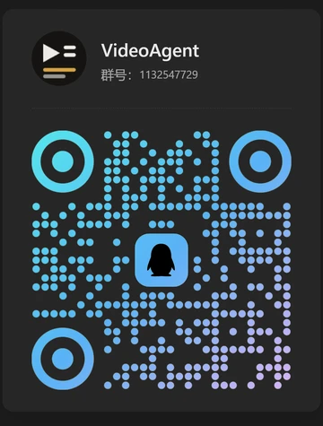
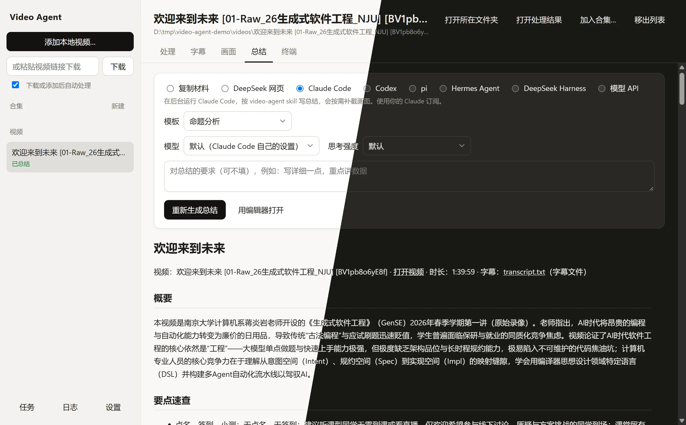
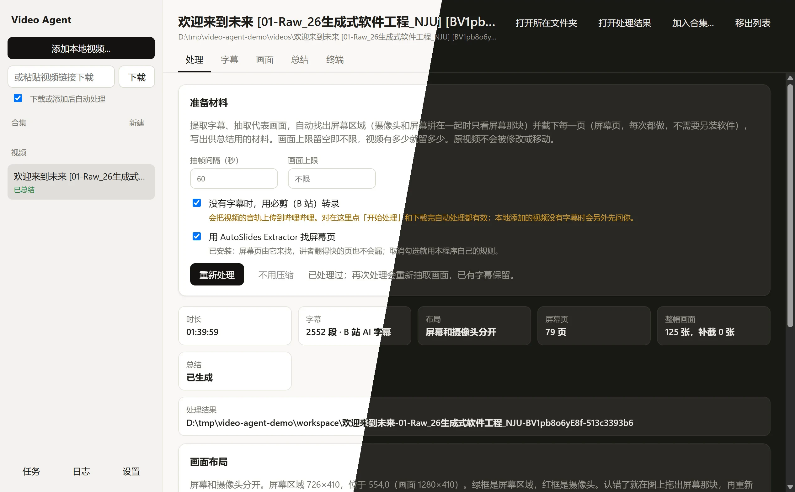
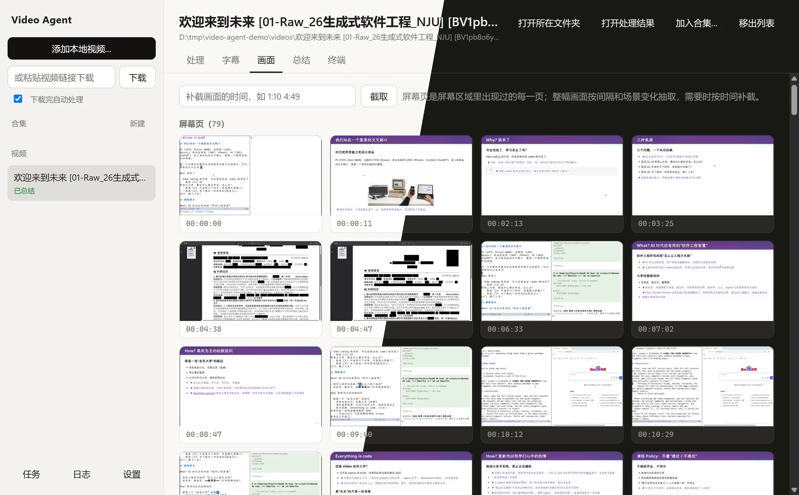
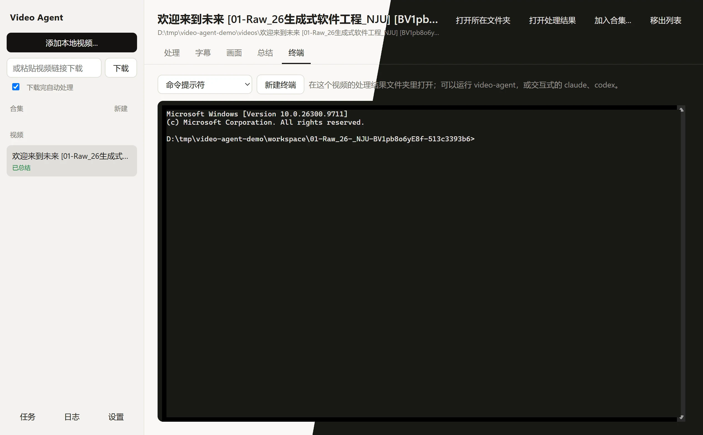

<div align="center">
  
  <h1>Video Agent</h1>
  <p>从视频到笔记：下载视频，提取字幕和屏幕画面，再由 Agent 写出带时间点和截图的总结。</p>
  <p>
    
    
    
    
    <a href="#交流群"></a>
  </p>
</div>

## 交流群

QQ 群：1132547729，用 QQ 扫码也可以加入。问题和建议也可以提 [issue](https://github.com/edsfod/video-agent/issues)。

<p align="center">
  
</p>

## 简介

<p align="center">
  
</p>

看一个视频（课堂录像、讲座、访谈、教程、新闻）很费时间，看完也记不住。Video Agent 把视频变成一份能代替看视频的笔记：视频讲了什么、要照办的事、日后能用上的内容，每一点都能回到视频的时间点，画面上的内容也写在里面。

**适用范围**：只支持 Windows。范围和不做的事见 [docs/requirements.md](docs/requirements.md)。

由三部分组成，按需取用：

- **桌面程序**：在窗口里完成全部操作，带内嵌终端、任务队列和托盘。
- **命令行工具** `video-agent`：下载、处理、写总结，供 Agent 和批量处理用。
- **Agent 插件**：让 Claude Code、Codex 等按同一套规则调用命令行工具、看画面、写总结。

## 能做什么

- **任何来源的视频**：本地文件直接用；粘贴链接时用 [yt-dlp](https://github.com/yt-dlp/yt-dlp) 下载。桌面程序下载或添加后默认自动处理。
- **字幕**：先用视频自带的、旁边的或下载时网站给的字幕；都没有时可以用必剪（B 站的语音识别）转录，音频要你同意才上传。听错的名字和术语可以改正，原字幕不动。
- **屏幕页和画面**：认出画面里哪块是屏幕、哪块是摄像头，用原始分辨率截下屏幕上出现过的每一页，同一页逐步出现的几步合成一页；其余画面按间隔和场景变化抽取，写总结时还能按时间补截。装了 [AutoSlides Extractor](https://github.com/bit-admin/AutoSlides-Extractor) 时由它找屏幕页。也可以导入一个放着课件图片的文件夹代替截图。
- **几种写总结的方式，写出同一种总结**：
  - **Agent 应用**：Claude Code 或 Codex 按插件里的 skill 写，自己补截画面；设置里也能换成 pi、Hermes Agent、DeepSeek Harness、Antigravity CLI（`agy`）或你自己的命令。
  - **分阶段**：装了 Antigravity 命令行（`winget install Google.AntigravityCLI`）时可选。视频分成单元，每个单元一个对话同时写，程序查出漏写的讲话、画面编号和链接的问题，只发回原对话改。长视频后半段也写得细；只能用自带的「标准」模板。
  - **模型 API**：Anthropic，或 OpenAI 兼容接口（例如 ModelScope、本地 Ollama）。
  - **网页 AI**：「复制材料」贴进任何聊天 AI，或连画面导出成 zip、文件夹；写好的总结「导入」存回来。程序查出缺漏时生成下一轮复查。
  - **DeepSeek 网页版**：在程序的窗口里全自动跑完几轮，第一次在里面登录。
- **总结的写法**：每一点附时间点；画面上的文字、表格、图表读进总结；分得清哪些是视频说的、视频引用别人的、总结者加的；拿不准的标「需确认」。自带「标准」模板，也可以照着做自己的。
- **版本**：重新总结不覆盖原来的，每一版都留着，由你决定用哪一版。
- **合集**：一门课、一个系列或一个播放列表编成合集，写合集总结和学习提纲；合集可以跟着播放列表收新视频。
- **压缩**：用 AV1 重新编码，分辨率不变、看不出画质差别，屏幕录像大约剩五分之一。默认只压缩本程序下载的视频。

## 安装

**桌面程序**（推荐）：从 [Releases](https://github.com/edsfod/video-agent/releases) 下载 `Video-Agent-Setup-<版本>.exe` 安装，不用另装任何东西，安装时也不需要联网：Python、FFmpeg、yt-dlp 和命令行工具都在安装包里。安装时会创建桌面和开始菜单快捷方式，并把命令行工具加进 PATH，新开的终端里就能用 `video-agent`。

**只装命令行工具**：先装 [uv](https://docs.astral.sh/uv/)（`winget install astral-sh.uv`），再运行

```powershell
uv tool install https://github.com/edsfod/video-agent/releases/download/v1.6.0/video_agent-1.6.0-py3-none-any.whl
```

FFmpeg 和 yt-dlp 会作为依赖一起装上，不需要 git。电脑上已经有的 ffmpeg、ffprobe、yt-dlp（包括 [Media Downloader](https://github.com/mhogomchungu/media-downloader) 自带的 yt-dlp）会优先使用。

**Agent 插件**

- 装了桌面程序：在设置里点「安装到 Claude Code」或「安装到 Codex」，从本机安装，不需要 git。
- 没装桌面程序：下面两组命令从 GitHub 拉取插件，需要电脑上有 git。
  - Claude Code：在 Claude Code 里运行

    ```
    /plugin marketplace add edsfod/video-agent
    /plugin install video-agent@video-agent
    ```

  - Codex：在终端里运行

    ```bash
    codex plugin marketplace add edsfod/video-agent
    codex plugin add video-agent@video-agent
    ```

- pi、Hermes Agent、DeepSeek Harness、Antigravity CLI：在设置里点「复制到 pi」等按钮，把 skill 文件夹复制到它们读 skill 的地方。别的 Agent 点「复制到其他文件夹…」，选它读 skill 的文件夹；没装桌面程序时，把 `skills/video-agent/` 复制过去。

插件找不到 `video-agent` 命令时，会用 uv 临时拉取同一版本。AutoSlides Extractor 要另外安装，或在桌面程序的设置里下载免安装版。

## 桌面程序

<p align="center">
  
</p>

添加本地视频（也可以拖进窗口），或在左上角粘贴链接下载。下载 B 站视频前，先在「设置 → 账号」里登录一次哔哩哔哩，字幕（包括 AI 字幕）会一起下载；抖音要在那里打开一次网页（不用登录）；YouTube 一般不用登录，遇到年龄限制或「确认你不是机器人」时再登录。

每个视频有五页：

- **处理**：开始处理；画面布局认错时，在 `layout.jpg` 上拖出屏幕区域重新处理。
- **画面**：列出屏幕页和代表画面，可以按时间补截，手动去掉或放回某张图。
- **字幕**：查看字幕，改正识别错的名字和术语；之后的总结都用改正后的字幕。
- **总结**：选择总结方式和模板，显示结果，点画面链接直接看图；在「版本」里查看、对比、设为当前、写备注。
- **终端**：在这个视频的处理结果文件夹里打开 PowerShell、命令提示符或 Git Bash，可以直接运行 `video-agent` 或交互式的 `claude`、`codex`。

<p align="center">
  
</p>

<p align="center">
  
</p>

此外：

- **合集和跟随列表**：侧栏「合集」→「新建」，或在视频页点「加入合集」。粘贴的是 B 站合集、播放列表这类链接时，会先问你要不要全部下载，并默认跟随这个列表：以后在合集页点「检查新视频」只下载新出的。
- **删除**：视频页的「删除…」，或在列表旁「选择」几个一起删。本程序下载的视频连文件一起删；你从本地添加的视频，文件留着不动。
- **任务队列**：下载、处理、总结都进入队列，左下角「任务」看进度和输出，可以停止或重试；同时跑几个在设置里改。
- **托盘和日志**：关闭窗口时程序缩到托盘，任务继续运行；每个任务的输出都记在左下角「日志」里。
- **总结模板**：在「设置 → 总结模板」里编辑自带的，或照着一份新建；更新程序不会覆盖你改过的模板。

## 命令行

```powershell
video-agent download "https://www.bilibili.com/video/BV..." -o D:\Videos
video-agent process "D:\Videos\lecture.mp4" -o D:\Video-Work
video-agent summarize "D:\Videos\lecture.mp4" -o D:\Video-Work
```

`process` 在工作区里为每个视频建一个文件夹，放字幕、画面、总结材料（`summary-context.md`）和 `manifest.json`，原视频不会被修改或移动。`summarize` 用模型 API 写 `总结.md`，先用 `video-agent config --provider anthropic --set-key` 设置一次。用网页 AI 时，`pack` 打出材料，写好后用 `summarize --import 文件.md` 存回来：

```powershell
video-agent pack "D:\Videos\lecture.mp4" -o D:\Video-Work --zip D:\lecture-材料.zip
video-agent summarize "D:\Videos\lecture.mp4" -o D:\Video-Work --import D:\总结.md
```

一步步的做法见 [docs/cli.md](docs/cli.md)，全部命令和选项见 [docs/commands.md](docs/commands.md)。

## 升级与卸载

**桌面程序**

- 升级：启动时检查一次有没有新版本，只提示，不自己下载（可在设置里关掉）。点「下载并更新」只下载变化的部分，再点「重启并安装」，装完自动重新打开。github.com 访问不了时改走 GitHub API 和下载镜像；更新文件带签名，签名对不上就不安装。设置、工作区和已装的插件都保留。
- 卸载：在 Windows 的「设置 → 应用 → 已安装的应用」里卸载 Video Agent。卸载会从 PATH 里去掉命令行工具、删掉更新缓存；工作区（默认 `Documents\Video Agent`）、设置（`%APPDATA%\Video Agent`、`%APPDATA%\video-agent`）和 Windows 凭据管理器里的 API key 都留着，不要了就手动删。

**只装了命令行工具**

- 升级：运行「安装」里那条命令，把链接里的版本号换成新版，再加 `--force`。
- 卸载：`uv tool uninstall video-agent`。

## 常见问题

| 现象 | 处理 |
|---|---|
| 运行安装包时 Windows SmartScreen 提示「未知发布者」 | 安装包没有代码签名。点「更多信息」，再选「仍要运行」 |
| 下载的 B 站视频没有字幕 | B 站只对登录的账号给字幕：先在「设置 → 账号」里登录哔哩哔哩再下载。命令行用 `--cookies cookies.txt` 传入登录状态 |
| 「从浏览器导入…」读不到登录状态 | Edge 开着时读不到，先关掉 Edge；Chrome 的读不了，改用 Firefox，或用浏览器扩展 Get cookies.txt LOCALLY 导出 cookies.txt 再导入 |
| 必剪转录报 `audio chunk 1: upload returned HTTP 502` | 代理规则挡了 `jssz-boss.biliapi.net`：在代理规则里放行这个域名。重试没有用 |
| 屏幕页很少，或截的不是屏幕 | 画面布局认错了。看 `frames/<本次运行>/layout.jpg` 上标出的区域：桌面程序在处理页的图上拖出屏幕区域重新处理，命令行用 `--screen-region X,Y,宽,高` |
| 命令行报 `Another Video Agent run is changing …` | 同一个视频的另一个处理或总结还在运行，等它结束再运行 |
| DeepSeek 网页任务很久没有动静 | 被限流时程序会等着，过后接着发同一条消息，不用手动重试 |

## 隐私和使用须知

程序什么时候联网、把什么发给谁，以及下载的内容怎么用、总结可能出错等须知，见 [PRIVACY.md](PRIVACY.md)。安装程序在安装前显示同样的内容，桌面程序里在「设置 → 关于」查看。

## 文档导航

| 文档 | 回答 |
|---|---|
| [docs/cli.md](docs/cli.md) | 用命令行从下载到总结怎么一步步做 |
| [docs/commands.md](docs/commands.md) | 每个命令和选项 |
| [PRIVACY.md](PRIVACY.md) | 什么时候联网、把什么发给谁、使用须知 |
| [docs/releases/](docs/releases/) | 每一版改了什么 |
| [docs/README.md](docs/README.md) | 要改代码或判断行为对不对：需求、设计、决策、测试和发布从这里看起 |
| [ARCHITECTURE.md](ARCHITECTURE.md) | 代码在哪、什么不能破坏、改一处要连带改哪里 |

## 许可证 · License

Copyright (C) 2026 edsfod

This program is free software: you can redistribute it and/or modify it under the terms of the GNU Affero General Public License as published by the Free Software Foundation, either version 3 of the License, or (at your option) any later version.

This program is distributed in the hope that it will be useful, but WITHOUT ANY WARRANTY; without even the implied warranty of MERCHANTABILITY or FITNESS FOR A PARTICULAR PURPOSE. See the GNU Affero General Public License for more details.

You should have received a copy of the GNU Affero General Public License along with this program (see [LICENSE](LICENSE)). If not, see <https://www.gnu.org/licenses/>.

中文提示：分发修改版，或让别人通过网络使用修改版时，须以同一许可证公开完整源码。以上英文和 [LICENSE](LICENSE) 原文为准。

## 鸣谢

- 下载用 [yt-dlp](https://github.com/yt-dlp/yt-dlp)，媒体处理用 [FFmpeg](https://ffmpeg.org/)（安装程序里是自己编译的 LGPL 版，带 [dav1d](https://code.videolan.org/videolan/dav1d) 解码 AV1，源码随每个发布版提供；用 uv 或 pip 安装时随 [imageio-ffmpeg](https://github.com/imageio/imageio-ffmpeg) 装上），安装程序里的命令行工具用 [PyInstaller](https://pyinstaller.org/) 打包，另外提取幻灯片用 [AutoSlides Extractor](https://github.com/bit-admin/AutoSlides-Extractor)。
- 界面的浅色和深色配色取自 [AutoSlides](https://github.com/bit-admin/Yanhekt-AutoSlides) 的主题文件（Apache License 2.0）；任务队列的设计（排队而不是拒绝、按类型限制同时运行的数量、去重）参考了它的下载队列，代码是本项目自己写的。
- 安装程序附带的所有第三方组件和它们的许可证，见安装目录里的 `THIRD-PARTY-NOTICES.txt`。
- 截图里的视频和字幕是南京大学《生成式软件工程》第 1 讲「欢迎来到未来」（蒋炎岩，[B 站公开课](https://www.bilibili.com/video/BV1pb8o6yE8f)），用于演示；课件和讲课内容的版权归讲者所有。截图里的总结由网页 AI 按本项目的规则写成，不代表讲者的观点，未经讲者审核；本项目与讲者和南京大学无关。
