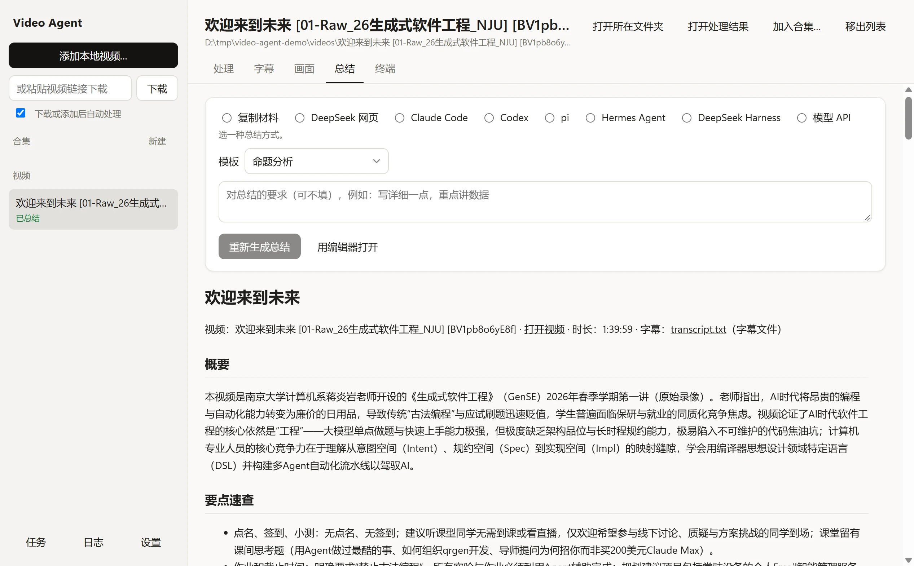
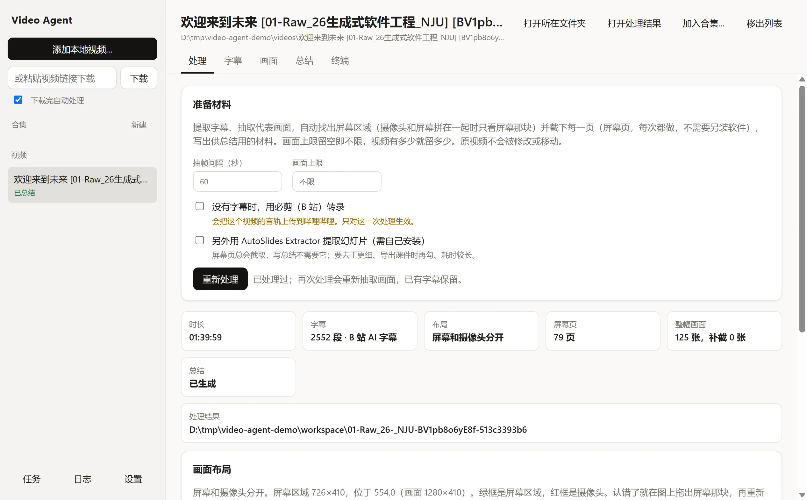
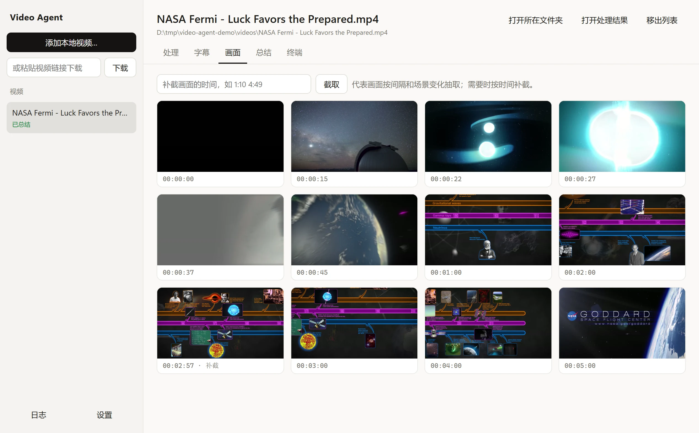
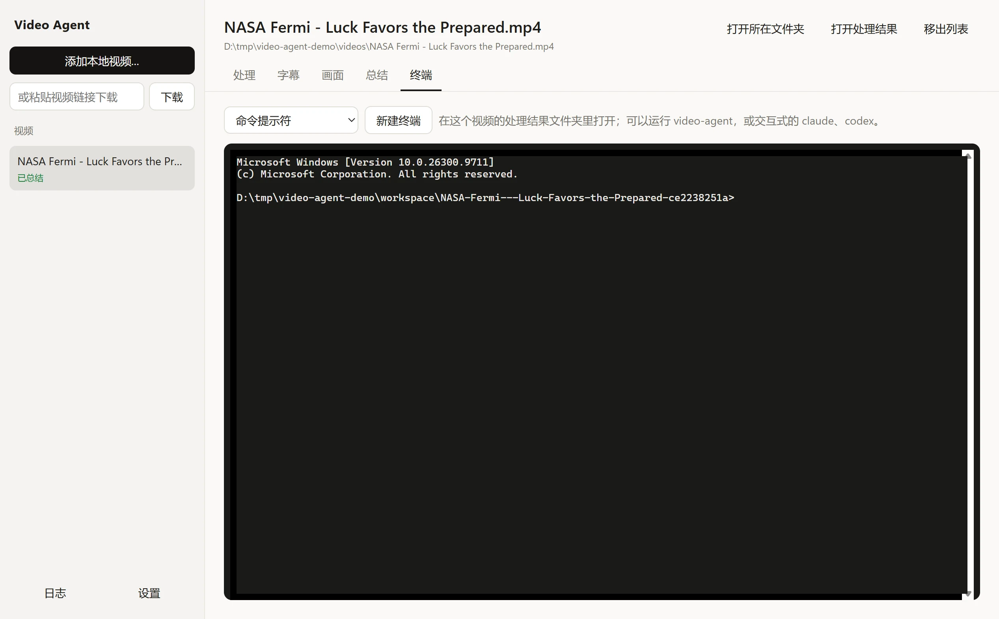

<div align="center">
  
  <h1>Video Agent</h1>
  <p>从视频到笔记：下载视频，提取字幕和屏幕画面，再由 Agent 写出带时间点和截图的总结。</p>
  <p>
    
    
    
    
  </p>
</div>

<p align="center">
  <picture>
    <source media="(prefers-color-scheme: dark)" srcset="docs/images/summary-dark.webp" />
    
  </picture>
</p>

Video Agent 由三部分组成，按需取用：

- **命令行工具**：下载（可选）、提取字幕、抽取代表画面、按时间点补截画面，并把这些整理成一份供总结用的材料。也可以直接调用模型 API 写总结。
- **Agent 插件**：让 Claude Code、Codex 按同一套规则调用命令行工具、看画面、写总结。
- **桌面程序**：在窗口里完成以上全部操作，内嵌终端，支持托盘和任务日志。

只支持 Windows。

## 能做什么

- **任何来源的视频**：直接选本地文件；也可以粘贴链接，用 [yt-dlp](https://github.com/yt-dlp/yt-dlp) 下载。桌面程序默认下载完自动处理（左上角可以关掉）；命令行里下载和处理是两步。
- **字幕优先**：先用视频自带的字幕或同名的 `.srt`、`.vtt` 文件（包括下载时一起存下的 `视频名.zh-CN.srt` 这类字幕）；都没有时，可以用必剪（B 站的语音识别）转录，但每次都要你明确同意上传音频。
- **屏幕页和代表画面**：自动识别画面布局，摄像头和屏幕拼在一起时只看屏幕那块，用原始分辨率截下每一页幻灯片、代码和文档（多少页就留多少页）；另外按时间间隔和场景变化抽取整幅画面。写总结时还可以按时间补截。
- **另外用 AutoSlides Extractor 提取幻灯片（可选，默认关闭，需自己安装）**：写总结用上面的屏幕页就够了；要更细的去重、导出课件时，可以再调用 [AutoSlides Extractor](https://github.com/bit-admin/AutoSlides-Extractor)。
- **四种总结方式**，写出的总结用同一套规则和模板：
  - Claude Code 或 Codex 按插件里的 skill 写，会自己补截画面；
  - 模型 API（Anthropic，或 OpenAI 兼容接口，例如 ModelScope、本地 Ollama），支持工具调用的模型同样会补截画面；
  - 复制材料，贴进任何聊天 AI。
- **总结的写法**：每一点都附时间点和画面出处；视频里的说法按“视频称”转述，不当成事实；拿不准的标“需确认”。

## 安装

**桌面程序**（推荐）：从 [Releases](https://github.com/edsfod/video-agent/releases) 下载 `Video-Agent-Setup-<版本>.exe` 安装，不用另装任何东西，也不需要联网：Python、FFmpeg、yt-dlp 和命令行工具都在安装包里。安装时会创建桌面和开始菜单快捷方式，并把命令行工具加进 PATH，新开的终端里就能用 `video-agent`。安装包没有代码签名，Windows SmartScreen 可能提示“未知发布者”，选“仍要运行”即可。

**只装命令行工具**：先装 [uv](https://docs.astral.sh/uv/)（`winget install astral-sh.uv`），再运行

```powershell
uv tool install https://github.com/edsfod/video-agent/releases/download/v0.6.2/video_agent-0.6.2-py3-none-any.whl
```

FFmpeg 和 yt-dlp 会作为依赖一起装上，不需要 git。电脑上已经有的 ffmpeg、ffprobe、yt-dlp（包括 [Media Downloader](https://github.com/mhogomchungu/media-downloader) 自带的 yt-dlp）会优先使用。

**Agent 插件**

- 装了桌面程序：在设置里点“安装到 Claude Code”或“安装到 Codex”，从本机安装，不需要 git。
- 没装桌面程序：下面两组命令从 GitHub 拉取插件，需要电脑上有 git。
  - Claude Code：在 Claude Code 里运行

    ```
    /plugin marketplace add edsfod/video-agent
    /plugin install video-agent@video-agent
    ```

  - Codex：在终端里运行

    ```bash
    codex plugin marketplace add edsfod/video-agent
    codex plugin add video-agent@video-agent
    ```

- 其他 Agent：把 `skills/video-agent/` 复制到它的技能目录。

插件找不到 `video-agent` 命令时，会用 uv 临时拉取同一版本。用 AutoSlides Extractor 提取幻灯片要另外安装它。

## 桌面程序

<p align="center">
  <picture>
    <source media="(prefers-color-scheme: dark)" srcset="docs/images/process-dark.webp" />
    
  </picture>
</p>

添加本地视频（也可以拖进窗口），或在左上角粘贴链接下载。下载 B 站视频前，先在「设置」里登录一次哔哩哔哩，字幕（包括 AI 字幕）会一起下载，处理时直接用，不必转录。在「处理」页开始处理：屏幕页每次都会截取，不需要另装软件；必剪转录和 AutoSlides Extractor 都是默认关闭的选项（没装 AutoSlides Extractor 时这一项是灰的），勾选必剪只对这一次处理生效。

<p align="center">
  <picture>
    <source media="(prefers-color-scheme: dark)" srcset="docs/images/frames-dark.webp" />
    
  </picture>
</p>

「画面」页列出代表画面，可以按时间补截；「字幕」页可以筛选字幕，也可以改正识别错的名字和术语（原始字幕保留，另存整理版，之后的总结都用整理版）；「总结」页选择总结方式并显示结果，点画面链接直接看图。

<p align="center">
  <picture>
    <source media="(prefers-color-scheme: dark)" srcset="docs/images/terminal-dark.webp" />
    
  </picture>
</p>

几个相关的视频可以放进一个「合集」（侧栏「合集」→「新建」，或在视频页点「加入合集」）。合集里的视频列在侧栏合集名下（点 ▸ 展开），不再出现在「视频」列表里，移出合集后回到列表。合集页面列出各集的状态，可以一次处理、总结没做完的几集，跳过没有内容的一集并写明原因，再生成合集总结和学习提纲，也能设置各集共用的术语改正。下载时粘贴的是 B 站合集、播放列表这类链接，会先问你要不要全部下载，默认放进一个以列表命名的合集并跟踪这个列表：以后在合集页点「检查新视频」只下载新出的，也可以让程序开着时每 6 小时自动检查。

「终端」页内嵌一个终端，可以选 PowerShell 7、Windows PowerShell、命令提示符或 Git Bash，打开在这个视频的处理结果文件夹里，可以直接运行 `video-agent` 或交互式的 `claude`、`codex`。

下载、处理、总结都进入任务队列：可以一边处理一个视频一边下载另一个，任务多了就排队，左下角「任务」看每个任务的进度和输出，可以停止或重试。默认同时下载 3 个、处理 1 个（处理很吃 CPU）、总结 2 个，可在设置里改；同一个视频的处理和总结不会同时进行。下载好的视频会自动排进处理，网站给的字幕随之导入（不想要就取消左上角的「下载完自动处理」）；必剪转录要上传音频，不会自动进行。

关闭窗口时程序缩到托盘，任务继续在后台运行（可在设置里关掉）。每个任务的完整输出都记在日志里，点左下角「日志」查看。

**总结规则**：几种总结方式都按同一份规则和模板写。在「设置 → 总结规则和模板」里点「编辑」，就会生成你自己的版本并用编辑器打开，可以改成更长、更短或固定要哪几节；更新程序不会覆盖它，默认规则有改动时会提示你对比。Agent 的 skill 流程只能查看，不能改。

**更新**：启动时会查一次有没有新版本，只提示，不会自己下载（可在设置里关掉）。设置里写着上次检查更新的时间和结果。点「下载并更新」，只下载和当前版本不同的部分，相近的部分合并成一次请求；再点「重启并安装」，装完自动重新打开。依次尝试 github.com、GitHub API 和下载镜像；更新文件带签名，镜像给出的文件对不上签名就不会安装。

## 命令行

```powershell
video-agent download "https://www.bilibili.com/video/BV..." -o D:\Videos
video-agent process "D:\Videos\lecture.mp4" -o D:\Video-Work
video-agent frame "D:\Videos\lecture.mp4" 1:10 4:49 -o D:\Video-Work
video-agent summarize "D:\Videos\lecture.mp4" -o D:\Video-Work
```

`download` 会把网站提供的字幕存在视频旁边（不要字幕加 `--no-subs`），`process` 会自动用上；有多份时先用人工字幕、中文优先，最后才是 AI 字幕。B 站只给登录的账号看字幕：命令行用 `--cookies cookies.txt` 传入登录状态（Netscape 格式）。浏览器正开着时 yt-dlp 读不到它的 cookie，而且新版 Edge、Chrome 加密的 cookie yt-dlp 也解不开，所以桌面程序里改用自带的 B 站登录窗口。

`process` 在工作区里为每个视频建一个文件夹，放字幕（`transcript.srt`、`transcript.txt`）、代表画面（`frames/`）、总结材料（`summary-context.md`）和 `manifest.json`，原视频不会被修改或移动。没有字幕时加 `--asr bcut --allow-remote-asr` 用必剪转录；加 `--extract-slides` 另外用 AutoSlides Extractor 提取幻灯片（会先裁出屏幕区域）。`video-agent tools` 列出会用到的 FFmpeg、ffprobe、yt-dlp 和 AutoSlides Extractor 各在哪里，没找到的写明。识别出的布局画在 `frames/<本次运行>/layout.jpg` 上（绿框是屏幕区域），认错了可以用 `--screen-region X,Y,宽,高` 手动指定。

用网页上的聊天 AI 写总结时，`pack` 打出提示词（加 `--zip 文件.zip` 连画面一起打包，画面保留原来的相对路径），写好后用 `summarize --import 文件.md` 存成 `总结.md`，画面链接照样有效：

```powershell
video-agent pack "D:\Videos\lecture.mp4" -o D:\Video-Work --zip D:\lecture-材料.zip
video-agent summarize "D:\Videos\lecture.mp4" -o D:\Video-Work --import D:\总结.md
```

几个相关的视频（一门课、一个系列、一个播放列表）可以组成合集：先给每个视频写总结，再写合集总结（需留意的事项、各集一览、主线），需要复习时写学习提纲（重点、按主题的要点、带答案的自测题）。合集共用一份术语改正，几乎没有内容的视频可以跳过并写明原因：

```powershell
video-agent collection create "机器学习" D:\Videos\ml-01.mp4 D:\Videos\ml-02.mp4 -o D:\Video-Work
video-agent collection terms "机器学习" --replace 剃度下降 梯度下降 -o D:\Video-Work
video-agent summarize --collection "机器学习" -o D:\Video-Work
video-agent summarize --collection "机器学习" --guide -o D:\Video-Work
video-agent download "https://www.bilibili.com/video/BV..." --playlist -o D:\Videos --collection "机器学习" --workspace D:\Video-Work
```

还在更新的连载、播放列表可以跟踪：下载时加 `--follow`（或之后用 `collection follow` 补上链接），以后运行 `collection update` 只下载新出的视频，按顺序加到合集末尾。已经下过的记在合集文件夹里的 `downloaded.txt`。

```powershell
video-agent download "https://space.bilibili.com/.../lists/...?type=season" --playlist --follow -o D:\Videos --collection "连载" --workspace D:\Video-Work
video-agent collection update "连载" -o D:\Video-Work
```

字幕里反复识别错的名字、术语可以用 `fix` 改正，原始字幕不动，另存整理版 `transcript.clean.*`，之后的总结都用它；`--remove` 撤销某一条：

```powershell
video-agent fix "D:\Videos\lecture.mp4" -o D:\Video-Work --replace 延和课堂 延河课堂 --replace react ReAct
```

`video-agent template --edit` 生成你自己的一份总结规则（`%APPDATA%\video-agent\summary.md`），之后各种总结方式都按它写；`--reset` 恢复默认。

`summarize` 用模型 API 写 `总结.md`。先设置一次服务商和 API key，key 存在 Windows 凭据管理器里，不写进文件：

```powershell
video-agent config --provider anthropic --set-key
video-agent config --provider openai --model Qwen/Qwen3.5-397B-A17B --base-url https://api-inference.modelscope.cn/v1 --set-key
```

全部命令和选项见 [docs/commands.md](docs/commands.md)，处理流程见 [docs/cli.md](docs/cli.md)，设计记录见 [ARCHITECTURE.md](ARCHITECTURE.md)。

## 隐私

- 必剪转录会把视频的音轨上传到哔哩哔哩，用的是必剪的非官方接口，随时可能失效。只有你明确同意时才会上传：命令行要同时加 `--asr bcut --allow-remote-asr`，桌面程序要勾选，Agent 要先问过你。
- 用模型 API 总结时，字幕和画面会发给你设置的服务商；用 Claude Code、Codex 时，由它们按各自的规则处理。
- 日志不记录 API key。
- 哔哩哔哩登录：在桌面程序里登录后，登录状态（cookie）只存在本机，安装版用 Windows 的 DPAPI 加密保存。只在下载 B 站视频时临时导出给 yt-dlp、发给 B 站，下载结束就删掉导出的文件；在设置里可以退出登录。
- 检查更新：桌面程序启动时会向 GitHub 查一次最新版本，连不上时依次改用 GitHub API 和下载镜像（gh-proxy.com、ghfast.top，或你在设置里填的镜像）。这些请求只是普通的下载请求，不附带你的视频、字幕、设置或其他数据；对方能看到的是你的 IP 地址和请求的文件。可以在设置里关掉启动时的检查。
- 除此之外，程序只在你要求时联网：下载链接（yt-dlp）、必剪转录、调用你设置的模型 API。

## 使用须知

- 下载、转录和截取的视频内容，版权属于原作者。请只用于个人学习，遵守视频网站的用户协议和当地法律，不要传播下载的视频。
- 必剪转录用的是哔哩哔哩的非官方接口，不在它的公开服务条款保障之内，随时可能失效或受限制。
- 总结由 AI 生成，可能有错，重要内容请对照原视频核实。

## 开发

```powershell
uv run pytest              # 命令行工具的测试
cd gui; npm ci; npm test   # 桌面程序的端到端测试（会打开窗口）
npm run dist               # 先用 PyInstaller 打包命令行工具（需要 uv，以及 build/ffmpeg：CI 的 ffmpeg-lgpl 产物，或在 MSYS2 里运行 packaging/ffmpeg/build.sh），再打包安装程序
npm run screenshots -- <工作区> <视频>   # 重新生成本页截图
```

## 许可证 · License

Copyright (C) 2026 edsfod

This program is free software: you can redistribute it and/or modify it under the terms of the GNU Affero General Public License as published by the Free Software Foundation, either version 3 of the License, or (at your option) any later version.

This program is distributed in the hope that it will be useful, but WITHOUT ANY WARRANTY; without even the implied warranty of MERCHANTABILITY or FITNESS FOR A PARTICULAR PURPOSE. See the GNU Affero General Public License for more details.

You should have received a copy of the GNU Affero General Public License along with this program (see [LICENSE](LICENSE)). If not, see <https://www.gnu.org/licenses/>.

中文提示：分发修改版，或让别人通过网络使用修改版时，须以同一许可证公开完整源码。以上英文和 [LICENSE](LICENSE) 原文为准。

## 鸣谢

- 下载用 [yt-dlp](https://github.com/yt-dlp/yt-dlp)，媒体处理用 [FFmpeg](https://ffmpeg.org/)（安装程序里是自己编译的 LGPL 版，带 [dav1d](https://code.videolan.org/videolan/dav1d) 解码 AV1，源码随每个发布版提供；用 uv 或 pip 安装时随 [imageio-ffmpeg](https://github.com/imageio/imageio-ffmpeg) 装上），安装程序里的命令行工具用 [PyInstaller](https://pyinstaller.org/) 打包，另外提取幻灯片用 [AutoSlides Extractor](https://github.com/bit-admin/AutoSlides-Extractor)。
- 界面的浅色和深色配色取自 [AutoSlides](https://github.com/bit-admin/Yanhekt-AutoSlides) 的主题文件（Apache License 2.0）；任务队列的设计（排队而不是拒绝、按类型限制同时运行的数量、去重）参考了它的下载队列，代码是本项目自己写的。
- 安装程序附带的所有第三方组件和它们的许可证，见安装目录里的 `THIRD-PARTY-NOTICES.txt`。
- 截图里的视频和字幕来自 NASA 戈达德太空飞行中心的 [NASA's Fermi Mission Shows How Luck Favors the Prepared](https://images.nasa.gov/details/GSFC_20181108_FERMI_m13042_Luck4K)（2018），按 [NASA 的媒体使用规定](https://www.nasa.gov/nasa-brand-center/images-and-media/)用于演示。截图里的总结由 AI（Qwen3.5，经模型 API）生成，不是 NASA 的说法，未经 NASA 审核，NASA 不对其准确性负责；本项目与 NASA 无关，也未获 NASA 认可。
